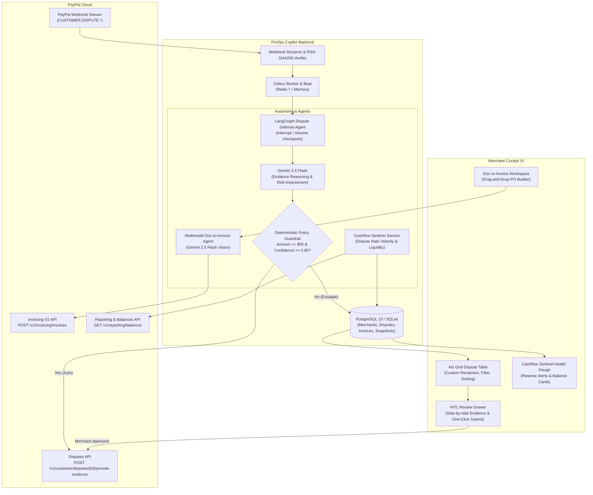

# PayPal FinOps Copilot

**Autonomous Financial Operations & Dispute Defense for SMB Merchants**  
*Built for the PayPal AI Hackathon (Devpost) | Powered by Google Gemini 2.5 Flash & AG Grid*

---

## 🎯 Executive Summary & The Problem

SMB merchants and e-commerce entrepreneurs lose over **$20 billion annually** to payment disputes, chargebacks, and sudden reserve holds. When a customer files a claim (`CUSTOMER.DISPUTE.CREATED`), merchants have a strict response window to collect shipping carrier records, warehouse order data, customer correspondence, and formulate an evidence package.

Failing to respond in time or breaching PayPal's **1.00% program dispute rate** results in catastrophic rolling reserves (where 10%–25% of gross processing volume is held for 90–180 days), freezing operating cashflow.

**PayPal FinOps Copilot** is an autonomous, multimodal financial operations agent that safeguards SMB merchants by:
1. **Defending Disputes Autonomously:** Ingesting dispute webhooks, gathering cross-system carrier proof of delivery, reasoning with **Google Gemini 2.5 Flash**, and auto-submitting compliant evidence packages via the PayPal Customer Disputes API—with deterministic **Human-in-the-Loop (HITL)** guardrails.
2. **Converting Purchase Orders to Invoices in Seconds:** Ingesting purchase orders, contracts, and receipts (PDFs/images) through Gemini 2.5 Flash multimodal vision and dispatching structured invoices via **PayPal Invoicing V2**.
3. **Forecasting Cashflow & Reserve Holds (Cashflow Sentinel):** Aggregating real-time balances, tracking 30-day transaction velocity, calculating dispute rates `(Disputes / Transactions) * 100`, and generating proactive alerts before accounts trigger PayPal reserve thresholds.

---

## 🏗️ System Architecture



---

## 🌟 Core Modules

### 1. Autonomous Dispute Defense Agent (LangGraph + HITL)
- **Direct REST Integration:** Submits evidence directly via `POST /v1/customer/disputes/{id}/provide-evidence` (bypassing limitation in Agent Toolkit / MCP which only support claim acceptance).
- **Multi-Source Evidence Aggregation:** Cross-references internal merchant ERP mock orders and real-time carrier tracking (FedEx, UPS, USPS) with delivery timestamp, recipient name, and signature proof.
- **Multimodal AI Reasoning:** Powered by **Google Gemini 2.5 Flash** to analyze claim validity, assess risk level (LOW/MEDIUM/HIGH), and compose a formal defense package.
- **Deterministic HITL Guardrails:** Hard code-level guardrail enforces that claims exceeding the merchant-configured threshold (default $50.00) or with confidence < 0.85 pause execution via LangGraph's `interrupt()` mechanism, awaiting merchant review.

### 2. Multimodal Doc-to-Invoice (Gemini 2.5 Flash Vision)
- Accepts uploaded purchase orders, contracts, and receipts in PDF or image format.
- Extracts invoice number, recipient billing details, currency, payment terms, and individual line items (quantities, unit prices, tax rates, line totals).
- Formats payloads into PayPal Invoicing V2 schemas and dispatches via `POST /v2/invoicing/invoices` and `POST /v2/invoicing/invoices/{id}/send`.

### 3. Cashflow Sentinel & Reserve Forecasting
- Monitors available vs. withheld/reserve balances across currencies via PayPal Reporting API.
- Automatically handles PayPal's hard **31-day query restriction** by partitioning date ranges into sequential chunks.
- Computes dispute velocity: `Dispute Rate = (Active Disputes / 30-Day Transactions) * 100`.
- Triages health status:
  - **Healthy (< 0.65%):** Optimal standing.
  - **Warning (0.65% - 0.99%):** Approaching program limits.
  - **Critical (>= 1.00%):** Immediate risk of rolling reserve holds and account limitations.
- Proactively generates alerts and persists daily `FinancialSnapshot` historical records.

---

## 🏆 Sponsor Prize Alignment

| Sponsor | Prize Pool | How FinOps Copilot Integrates |
|---|---|---|
| **AG Grid** | **$10,000 Cash** | Powers the core dispute operations cockpit with `ag-grid-react` v32. Custom cell renderers for transaction IDs, currency amounts, colored status badges, AI confidence progress bars, and custom action buttons invoking the HITL Review modal. |
| **Render** | **$2,250 Credits** | Full-stack cloud deployment configured via `render.yaml` deploying FastAPI web service, Celery background worker, PostgreSQL 15, Redis 7, and static Vite frontend. |
| **Postman** | **Sponsor Track** | Comprehensive collection and environment exported in `postman/PayPal_FinOps_Copilot.postman_collection.json` covering all REST API endpoints. |
| **APIMatic** | **$3,000 Cash** | Fully compliant OpenAPI 3.1 schema and SDK validation across all endpoints at `/openapi.json`. |

---

## 🚀 Quickstart & Local Setup

### Option A: Standalone Local Run (Zero Docker Required)

#### 1. Backend Setup (Python 3.12)
```bash
cd backend
python -m venv .venv
# Windows: .venv\Scripts\activate | Unix: source .venv/bin/activate
pip install -r requirements.txt

# Run database seeder (seeds test merchant, orders, tracking, disputes, snapshots)
python -m app.database.seed

# Start FastAPI server
uvicorn app.main:app --reload --port 8000
```
API runs at `http://localhost:8000/docs`.

#### 2. Frontend Setup (Node 18+)
```bash
cd frontend
npm install
npm run dev
```
Dashboard runs at `http://localhost:5173`.

---

### Option B: Full-Stack Docker Compose

Run all services (PostgreSQL 15, Redis 7, FastAPI, Celery Worker, Flower):
```bash
docker compose up --build
```
- Frontend Dashboard: `http://localhost:5173`
- FastAPI & Swagger Docs: `http://localhost:8000/docs`
- Flower Task Monitor: `http://localhost:5555`

---

## 🧪 Comprehensive Verification Suite

Run all 16 backend unit and integration tests:
```bash
cd backend
.venv\Scripts\python.exe -m pytest tests -v
```
**Results (100% Passing):**
- `tests/test_dispute_agent.py`: Autonomous defense, HITL interrupt/resume, and concede flows (3 passed)
- `tests/test_invoice_pipeline.py`: Gemini multimodal vision extraction, draft creation, PayPal dispatch (4 passed)
- `tests/test_cashflow.py`: Sentinel calculation, dispute rate breach alerts, sync endpoint (4 passed)
- `tests/test_paypal_clients.py`: OAuth2 token caching, direct `provide-evidence`, carrier simulation (4 passed)
- `tests/test_webhooks.py`: RSA-SHA256 signature verification and idempotency (1 passed)

Build the production frontend:
```bash
cd frontend
npm run build
```
*(Compiled cleanly with zero TypeScript errors or warnings).*

---

## 🎬 3-Minute Video Demo Script

1. **[0:00 - 0:40] The Problem:**
   - Introduce SMB merchant Sarah selling high-ticket electronics on Shopify & PayPal.
   - Show how chargeback notifications disrupt her day and the terror of triggering a 10% rolling reserve hold.
2. **[0:40 - 1:30] Autonomous Dispute Defense in Action:**
   - A `CUSTOMER.DISPUTE.CREATED` webhook fires for transaction `TXN-PP-001`.
   - FinOps Copilot instantly pulls tracking from FedEx, verifies signed proof of delivery, and runs Gemini 2.5 Flash reasoning.
   - Show the **AG Grid** dispute table: low-dollar claims (< $50) are defended autonomously!
   - High-dollar claims ($380.00) escalate into the **Human-in-the-Loop Review Console**: Sarah inspects the side-by-side evidence and clicks "Approve & Submit Evidence" in one click.
3. **[1:30 - 2:15] Multimodal Doc-to-Invoice:**
   - Sarah drags a PDF purchase order into the workspace.
   - Gemini 2.5 Flash Vision extracts line items, pricing, and buyer information with 98% confidence.
   - One click dispatches the invoice directly through **PayPal Invoicing V2**.
4. **[2:15 - 3:00] Cashflow Sentinel & Wrap-up:**
   - Demonstrate the Dispute Rate Health Gauge: Sarah stays at 0.42% (safely below PayPal's 1.00% threshold).
   - Show proactive liquidity warnings before holds happen.
   - Highlight full-stack deployment on **Render**, **AG Grid** tables, and **Google Gemini 2.5 Flash**.

---

## 📄 License
MIT License. Built with ❤️ for the PayPal AI Hackathon 2026.
